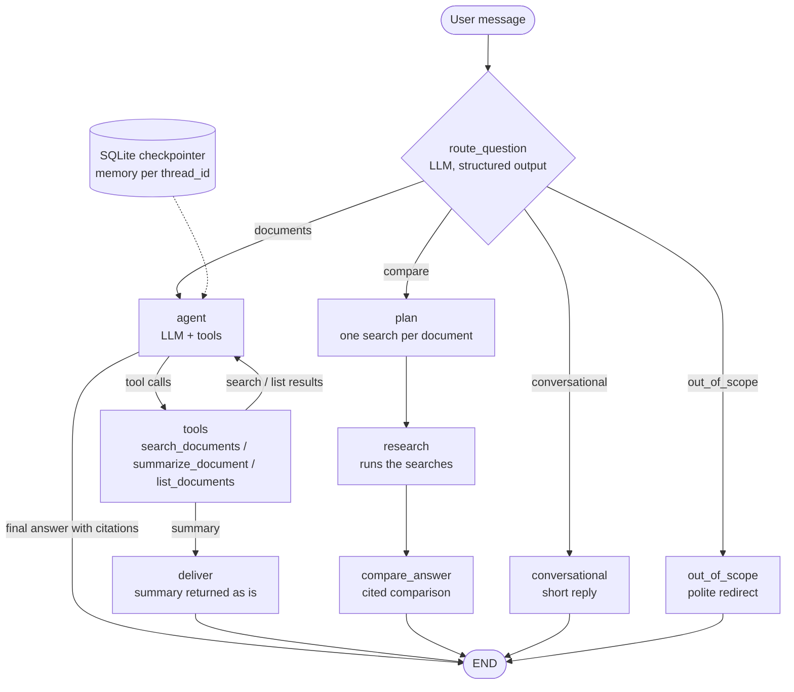

# Agentic Document Assistant

A multi-step LangGraph agent that routes each question, calls retrieval and summarization tools, and
answers with citations, keeping per-conversation memory. It runs fully locally with Ollama
(`llama3.1:8b`) or with Claude, and retrieves through [rag-knowledge-pipeline](https://github.com/fzee999/rag-knowledge-pipeline).



## How it works

| Piece | Where | What it does |
|---|---|---|
| Router | `graph.py` `route_question` | The LLM classifies the latest message as `documents`, `compare`, `conversational` or `out_of_scope`, using JSON-schema structured output. It reads recent turns, so follow-ups route correctly. |
| Agent + tool loop | `graph.py` `agent` + `ToolNode` | The LLM picks tools, can search again with new keywords, then answers with `[source p.N]` citations. |
| Tools | `tools.py` | `search_documents(query, source?)`, `summarize_document(source, focus?)` (map-reduce over long documents), `list_documents()`. Document names the model guesses ("travel-and-expense-policy.md", "CSF 2.0") are matched to real files by word overlap weighted by how rare each word is. A `source` is a soft filter: filtered and unfiltered results are fused, so a wrong guess can't hide the answer. |
| Comparison path | `graph.py` `plan` / `research` / `compare_answer` | For "does A agree with B?" questions, the LLM plans one search per document (structured output), code runs them, and the LLM answers from the per-document passages (plan-and-execute). |
| Deliver | `graph.py` `deliver` | Summaries go straight to the user instead of through another LLM pass, which small models tend to garble. |
| Memory | `memory.py` | LangGraph `SqliteSaver` checkpointer keyed by `thread_id`, so conversations survive restarts and can be resumed. |
| UIs | `app.py`, `cli.py` | Streamlit chat (threads, document upload, a live "agent steps" panel) and a `docagent` CLI. |

Design notes:
- **Provider-agnostic.** `RAG_PROVIDER=ollama` (default) or `anthropic`. The graph only uses LangChain
  interfaces (`bind_tools`, `with_structured_output`).
- **Append-only history.** With Claude, thinking blocks are bound to the exact conversation that produced
  them, so the agent keeps one fixed system prompt and tool set, and history is never trimmed or
  rewritten. A test guards this.
- **Map-reduce summaries** split documents that don't fit the local model's context into parts,
  summarize each, then summarize the summaries.

## Quickstart (Windows)

Prerequisites: Python 3.11 or 3.12, and [Ollama](https://ollama.com) with a tool-calling model:

```bash
ollama pull llama3.1:8b
```

This repo uses [rag-knowledge-pipeline](https://github.com/fzee999/rag-knowledge-pipeline) as a library, so clone both side by side:

```bash
git clone https://github.com/fzee999/rag-knowledge-pipeline.git
```
```bash
git clone https://github.com/fzee999/agentic-doc-assistant.git
```
```bash
cd agentic-doc-assistant
```

Then:

```bash
py -3.12 -m venv .venv
```
```bash
.venv\Scripts\activate
```
```bash
pip install -e ../rag-knowledge-pipeline -e ".[dev]"
```

Build this app's index from the real corpus (download it first with `python scripts/download_corpus.py`
in the pipeline repo):

```bash
docagent ingest ../rag-knowledge-pipeline/data/raw
```
```bash
streamlit run app.py
```

Or use the CLI: `docagent chat` (interactive, resumable with `--thread <id>`), or `docagent ask "<question>" --thread demo`.

No API key is needed. For Claude, copy `.env.example` to `.env` and set `RAG_PROVIDER=anthropic` and
`ANTHROPIC_API_KEY`.

## Evaluation

`eval/agent_questions.jsonl` has 15 prompts covering every route: single-fact search, a memory
follow-up, summaries, listing, cross-document comparisons, small talk and out-of-scope requests. Each
prompt has an expected route, the tools it should use, and key answer phrases checked against the source
documents.

```bash
docagent eval --out results.json
```

Results with `llama3.1:8b` on an RTX 4060 laptop GPU (~8.5 s per turn):

| | Routing | Tool choice | Answers |
|---|---|---|---|
| Baseline (vector retrieval, no comparison path) | 0.80 | 1.00 | 0.55 (6/11) |
| **Now** | **1.00** | **1.00** | **0.91** (10/11) |

What changed between the two: hybrid search + reranking and a 250-character chunk overlap in the
pipeline, the comparison path, the soft source filter, and router prompt fixes. Each change was
re-measured on the whole set.

- Fixed: the six functions of CSF 2.0 (it used to invent "Continuously Improve"); "Does GitLab agree
  with NIST on password length?" (now: GitLab doesn't set one, NIST requires 15 characters); failed-login
  limits (the model filtered to the wrong PDF, and the soft filter still found the right one);
  "What's the capital of France?" (now out of scope).
- Remaining miss: "How long do I have to submit an expense claim before it needs my manager's
  approval?" The policy has two deadlines (fiscal quarter end, and 90 days for manager approval), and
  the model answers with the first.
- 15 prompts is a small set, so read these as trends.

## Tests

```bash
pytest
```

14 tests. A scripted fake model drives the real graph, covering routing, the tool loop, summary
delivery, the comparison path, per-thread memory, append-only history, the soft source filter and
document-name resolution, with no LLM or API key.

## Next steps

- A bigger agent eval set (multi-turn, unanswerable and ambiguous questions).
- Try `qwen3:8b` or another stronger local tool-calling model and compare on the eval.
- Streaming tokens into the UI (`stream_mode="messages"`).
- Summarised memory for long chats on Ollama's 16K context.
