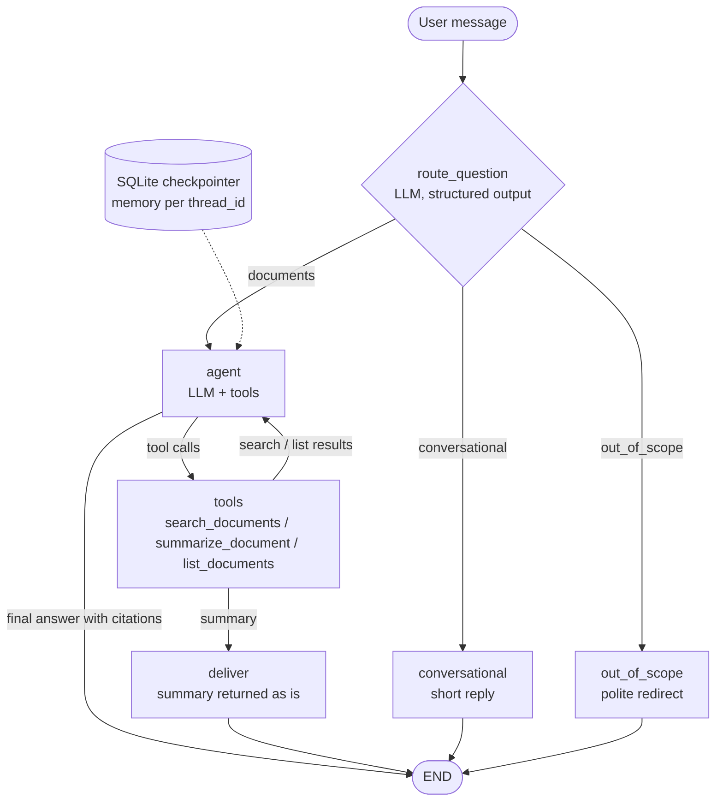

# Agentic Document Assistant

A multi-step LangGraph agent that routes each question, calls retrieval and summarization tools, and
answers with citations, keeping per-conversation memory. It runs fully locally with Ollama
(`llama3.1:8b`) or with Claude, and retrieves through [rag-knowledge-pipeline](../rag-knowledge-pipeline).



## How it works

| Piece | Where | What it does |
|---|---|---|
| Router | `graph.py` `route_question` | The LLM classifies the latest message as `documents`, `conversational` or `out_of_scope`, using JSON-schema structured output. It reads recent turns, so follow-ups route correctly. |
| Agent + tool loop | `graph.py` `agent` + `ToolNode` | The LLM picks tools, can search again with new keywords, then answers with `[source p.N]` citations. |
| Tools | `tools.py` | `search_documents(query, source?)`, `summarize_document(source, focus?)` (map-reduce over long documents), `list_documents()`. Document names the model guesses ("travel-and-expense-policy.md", "CSF 2.0") are matched to real files by word overlap weighted by how rare each word is. |
| Deliver | `graph.py` `deliver` | Summaries go straight to the user instead of through another LLM pass, which small models tend to garble. |
| Memory | `memory.py` | LangGraph `SqliteSaver` checkpointer keyed by `thread_id`, so conversations survive restarts and can be resumed. |
| UIs | `app.py`, `cli.py` | Streamlit chat (threads, document upload, a live "agent steps" panel) and a `docagent` CLI. |

Design notes:
- **Provider-agnostic.** `RAG_PROVIDER=ollama` (default) or `anthropic`. The graph only uses LangChain
  interfaces (`bind_tools`, `with_structured_output`).
- **Append-only history.** With Claude, thinking blocks are bound to the exact conversation that produced
  them, so the agent keeps one fixed system prompt and tool set, and history is never trimmed or
  rewritten. A test guards this.
- **Map-reduce summaries** split documents that don't fit the local model's context into parts,
  summarize each, then summarize the summaries.

## Quickstart (Windows)

Prerequisites: Python 3.11 or 3.12, and [Ollama](https://ollama.com) with a tool-calling model:

```bash
ollama pull llama3.1:8b
```

Clone this repo next to `rag-knowledge-pipeline`, then:

```bash
py -3.12 -m venv .venv
```
```bash
.venv\Scripts\activate
```
```bash
pip install -e ../rag-knowledge-pipeline -e ".[dev]"
```

Build this app's index from the real corpus (download it first with `python scripts/download_corpus.py`
in the pipeline repo):

```bash
docagent ingest ../rag-knowledge-pipeline/data/raw
```
```bash
streamlit run app.py
```

Or use the CLI: `docagent chat` (interactive, resumable with `--thread <id>`), or `docagent ask "<question>" --thread demo`.

No API key is needed. For Claude, copy `.env.example` to `.env` and set `RAG_PROVIDER=anthropic` and
`ANTHROPIC_API_KEY`.

## Live results with llama3.1:8b (RTX 4060 laptop GPU)

| Prompt | Route | What happened |
|---|---|---|
| "Which one of those covers incident response?" (follow-up) | documents | Resolved "those" from memory; cited RESPOND and its four categories from CSF 2.0 ✅ |
| "Summarize GitLab's travel and expense policy." | documents | Guessed path resolved to `expenses.md`; map-reduce summary of 21 concrete limits, spot-checked against the source ✅ (~1 min) |
| "Write me a poem about cats." | out_of_scope | Polite redirect, no tool calls ✅ |
| "Thanks, that was helpful!" | conversational | Short reply ✅ |
| "What are the six functions of the NIST CSF 2.0?" | documents | ❌ Retrieval surfaced overview and table-of-contents pages, not the list on p.8, and the model invented "Continuously Improve" |
| "Does GitLab's password guidance agree with NIST on length?" | documents | ❌ Searched only the CSF PDF (wrong document), so a weak answer |

The failures are mostly retrieval ranking (the next fix is reranking or hybrid search in the pipeline)
and small-model planning. A stronger tool-calling model, such as Claude or a larger local model, does
better on multi-document questions.

## Tests

```bash
pytest
```

13 tests. A scripted fake model drives the real graph, covering routing, the tool loop, summary
delivery, per-thread memory, append-only history and document-name resolution, with no LLM or API key.

## Next steps

- Reranking or hybrid search in the pipeline, to fix the CSF retrieval miss.
- An agent eval: routing accuracy and tool choice on a labelled question set.
- Streaming tokens into the UI (`stream_mode="messages"`).
- Try `qwen3:8b` or another stronger local tool-calling model and compare on the eval.
